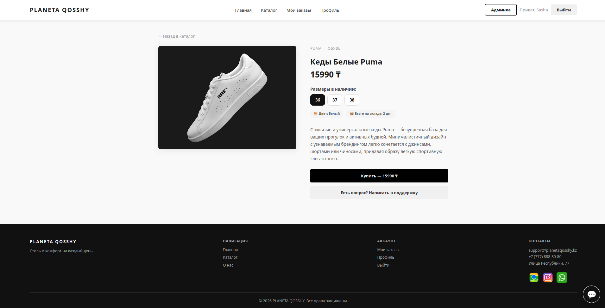
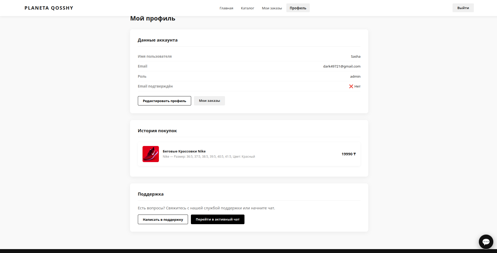
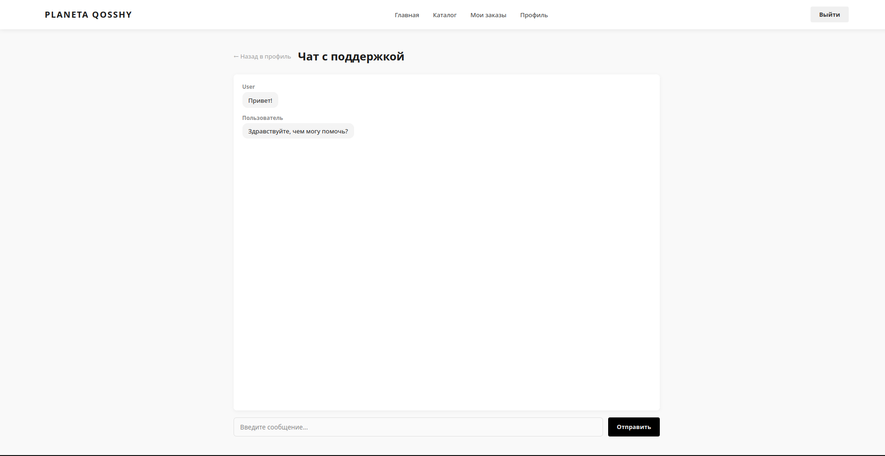
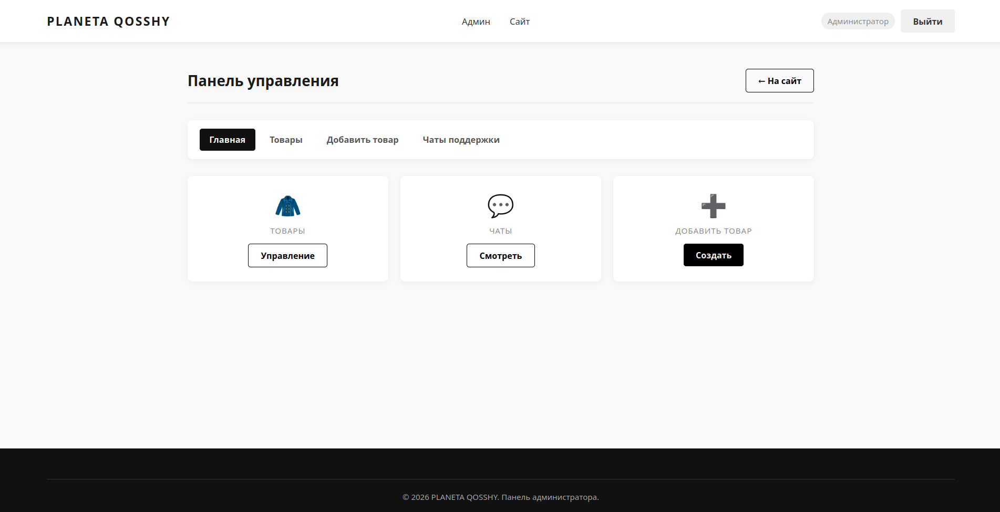
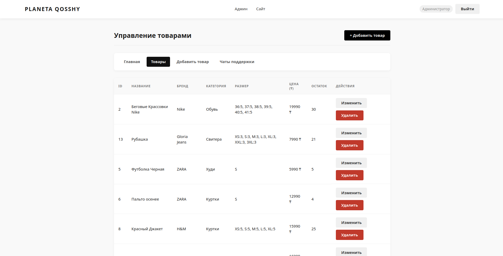
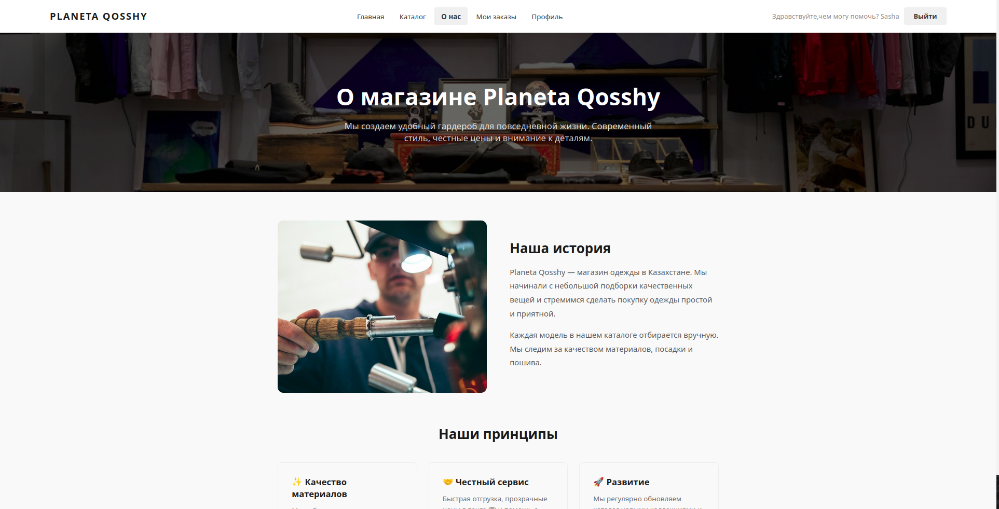
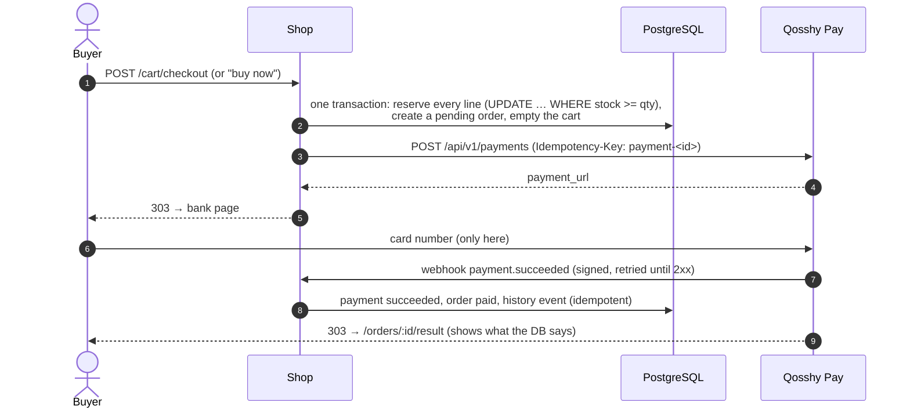
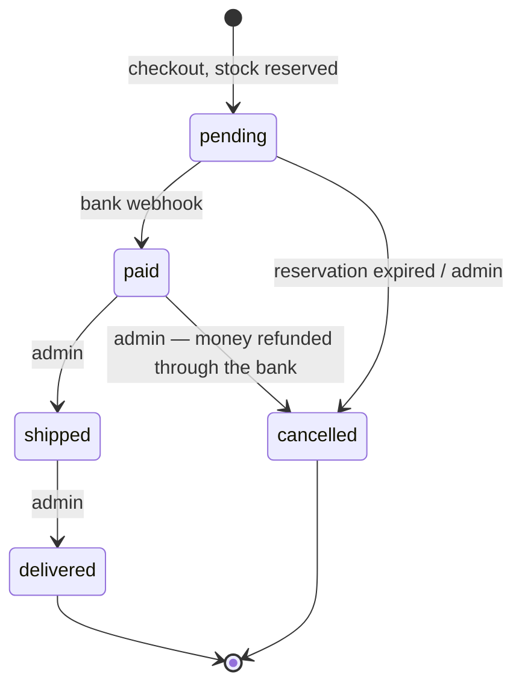
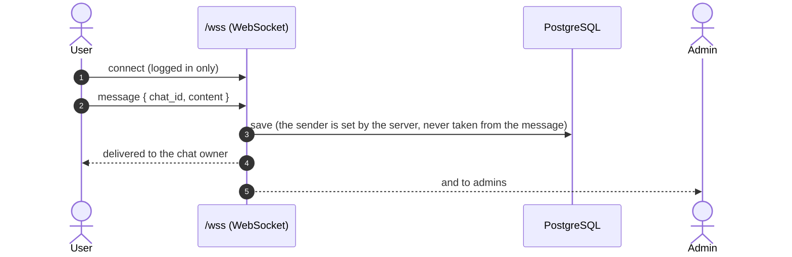

## 👕 Planeta Qosshy — Clothes Selling Services Platform

**Planeta Qosshy** is a full-stack e-commerce web application built in **Go (Golang)** using the **Gin Web Framework**, **GORM ORM**, **PostgreSQL**, **Gorilla WebSockets**, and **Gorilla Sessions**. 

The platform supports user authentication with email verification, clothes catalog browsing with detailed item views, order processing, external payment gateway integration, real-time live support chat via WebSockets, email helpdesk support, user profile management, and a comprehensive admin dashboard.

---

### 🖼 UI Preview / Скриншоты интерфейса

#### 🛍 1. Витрина и Карточка товара
<p align="center">
  
  
</p>

#### 👤 2. Профиль пользователя и Онлайн-чат поддержки
<p align="center">
  
  
</p>

#### ⚙️ 3. Панель Администратора
<p align="center">
  
  
</p>

#### ℹ️ 4. О компании
<p align="center">
  
</p>

---

### 📐 Architecture & Technology Stack

| Layer / Aspect | Technology / Library | Description |
| :--- | :--- | :--- |
| **Language** | Go 1.25 | Core backend server |
| **Web Framework** | [Gin Gonic](https://github.com/gin-gonic/gin) | HTTP router, request handling, HTML template rendering |
| **Database & ORM** | [GORM](https://gorm.io/) + PostgreSQL 16 | Data access; the schema itself is owned by SQL migrations |
| **Migrations** | [golang-migrate](https://github.com/golang-migrate/migrate) | Versioned `up`/`down` SQL files in `migrations/`, embedded into the binary, applied at startup |
| **Payments** | Qosshy Pay ([planeta_qosshy_microservice](https://github.com/SauletTheBest/planeta_qosshy_microservice)) | Test acquirer: hosted card page, signed webhooks, refunds |
| **Sessions** | [Gorilla Sessions](https://github.com/gorilla/sessions) | Signed cookie with the user ID and the login time only |
| **Real-time chat** | [Gorilla WebSocket](https://github.com/gorilla/websocket) | Live support chat |
| **Email** | [Gomail v2](https://gopkg.in/gomail.v2) | Email confirmation, password reset, helpdesk |
| **Security** | bcrypt, `http.CrossOriginProtection`, per-IP rate limits | Passwords, CSRF, brute force |
| **Logging** | [Logrus](https://github.com/sirupsen/logrus) | One JSON line per request to stdout, with `X-Request-ID` |
| **Containers** | Docker & Docker Compose | Non-root images with health checks |
| **CI** | GitHub Actions | `go vet`, tests with `-race` against a real PostgreSQL, Docker build |

---

### 🧩 Two services

```text
 Browser ──────────► Planeta Qosshy (shop, :8080) ──────► PostgreSQL
    │                     │        ▲
    │   POST /api/v1/payments      │  signed webhook
    │   (API key, Idempotency-Key) │  POST /payments/webhook  (HMAC-SHA256)
    │                     ▼        │
    └──── card form ──► Qosshy Pay (test bank, :8081)
```

The shop never sees a card number: the buyer types it on the bank's page.
An order becomes **paid only when the bank's signed webhook says so** — never because
the browser came back with "success" in the URL.

---

### 📦 Package Structure & Responsibilities

```text
Planeta_Qosshy/
├── main.go             # Startup, http.Server with timeouts, graceful shutdown (SIGTERM)
├── controllers/        # HTTP handlers: read the request, call shop/, render a page
│   ├── admin_*.go      #   dashboard, orders, users, products, support chats
│   ├── cart_controller.go, payment_controller.go, password_controller.go, ...
│   ├── health.go       #   /healthz (alive) and /readyz (database reachable)
│   └── upload.go       #   product photos: content sniffing, size limits, random names
├── shop/               # Business rules, no HTTP: orders, stock, payments, refunds, cart, stats
│   └── integration_test.go  # races and transactions against a real PostgreSQL
├── payments/           # Everything about the payment provider: API client, webhook signature
├── money/              # Money as int64 tiyn (1 ₸ = 100 tiyn) — never float
├── migrations/         # 000001…000008 *.up.sql / *.down.sql, embedded with go:embed
├── database/           # Connection pool, migrations runner, error helpers
├── middleware/         # Auth, admin role, CSRF guard, per-IP rate limit, JSON logger, flash messages
├── models/             # GORM models: User, Clothes(+Variants), Order(+Items, Payments, Events), Cart...
├── routes/routes.go    # All routes and template helpers
├── templates/          # Server-side HTML (shared admin parts in _admin_parts.html)
├── util/               # Email, validation, random tokens
├── scripts/e2e/        # End-to-end checks: real shop + real bank + temp DB, 184 checks
└── .github/workflows/  # CI
```

---

### 🔄 Data Flows & Workflows

#### 1. Checkout and payment



If the buyer doesn't pay within the reservation time (15 min), a background job cancels
the order and puts the items back on sale.

#### 2. Order statuses



Only these transitions exist (`shop/admin.go`); the admin page draws its buttons from the
same table. Every change is written to `order_events`, so each order has a history:
who did what and when.

#### 3. Refunds

Cancelling a paid order returns the stock and asks the bank for a refund. If the bank is
unreachable, the payment stays in the **"Нужен возврат"** list with a retry button. A
payment that arrives after an admin cancelled the order is flagged for refund too — it
does not bring the order back.

#### 4. Real-time support chat



---

### 🔐 Security notes

- No raw SQL from users anywhere; every value goes to the DB as a parameter.
- Passwords: bcrypt. Email-link tokens (confirmation, password reset): only their SHA-256
  hash is stored, links expire (24 h / 1 h) and work once.
- Changing or resetting a password logs out every other session.
- CSRF: `http.CrossOriginProtection` (Go 1.25) + `SameSite=Lax` cookies.
- Rate limits per client IP on login, sign-up, password reset and helpdesk
  (`TRUSTED_PROXIES` decides who may set `X-Forwarded-For`).
- Uploaded files are checked by their content, not their extension, and get random names.
- Logs never contain query strings or SQL values (tokens would leak into them).

---

### 🐳 Running with Docker Compose (recommended)

Both repositories must sit next to each other:

```text
PlanetaQosshy/
├── Planeta_Qosshy/                # this repo
└── planeta_qosshy_microservice/   # the test bank
```

1. **Create `.env`** from the example and fill in random secrets (Git Bash: `openssl rand -base64 32`):
   ```bash
   cp .env.example .env
   ```
   `COOKIE_SECRET`, `POSTGRES_PASSWORD`, `PAYMENT_API_KEY` and `PAYMENT_WEBHOOK_SECRET` are
   required; the API key and the webhook secret must be two **different** values.

2. **Start**:
   ```bash
   docker compose up --build -d
   docker compose ps          # api and payments should become "healthy"
   docker compose logs -f api
   ```
   Open <http://localhost:8080>. Migrations run automatically at startup.

3. **Make yourself an admin** (after registering on the site):
   ```bash
   docker compose exec postgres psql -U postgres -d planeta_qosshy \
     -c "UPDATE users SET role = 'admin' WHERE email = 'you@example.com'"
   ```
   From then on roles are changed in the admin panel: **/admin/users**.

4. **Test cards** on the bank page:

   | Card | Result |
   | :--- | :--- |
   | `4242 4242 4242 4242` | success |
   | `4000 0000 0000 0002` | declined |
   | `4000 0000 0000 9995` | insufficient funds |

   Any future expiry date and any 3-digit CVV.

5. **Stop**:
   ```bash
   docker compose down        # stops the containers, KEEPS the data
   ```
   ⚠️ `docker compose down -v` also deletes the volumes: the database, uploaded photos
   and the bank's payments.

---

### ⚙️ Environment variables

All of them are listed with comments in [`.env.example`](.env.example). The main ones:

| Variable | Required | What it is |
| :--- | :---: | :--- |
| `DATABASE_URL` | ✅ | PostgreSQL connection (docker-compose builds it itself) |
| `COOKIE_SECRET` | ✅ | Signs the session cookie, 32+ characters |
| `PAYMENT_API_URL` / `PAYMENT_API_KEY` / `PAYMENT_WEBHOOK_SECRET` | ✅ | Qosshy Pay address and the two shared secrets |
| `PUBLIC_URL` | | How browsers reach the shop (links in emails, return from the bank, CSRF) |
| `COOKIE_SECURE` | | `true` behind HTTPS |
| `SMTP_HOST` / `SMTP_PORT` / `SMTP_USER` / `SMTP_PASS` / `SUPPORT_EMAIL` | | Email; without them emails are skipped |
| `ORDER_RESERVATION_TTL` | | How long an unpaid order holds its items (default `15m`) |
| `SHOP_TIMEZONE` | | Where "today" starts in the statistics (default `Asia/Almaty`) |
| `TRUSTED_PROXIES` / `TRUSTED_ORIGINS` | | IPs of a reverse proxy; extra site addresses for forms |
| `UPLOAD_DIR` | | Product photos (default `uploads`) |
| `DB_MAX_OPEN_CONNS` | | Connection pool size (default 20) |
| `PORT`, `LOG_FILE`, `GIN_MODE` | | Port (8080), optional log file, `release` in Docker |

---

### 🗃 Database migrations

The schema lives in `migrations/NNNNNN_name.up.sql` (+ `.down.sql` to roll back). At startup
the app applies the ones the database doesn't have yet and records the version in
`schema_migrations`. To change the schema, **add a new file** with the next number —
never edit a migration that has already run somewhere.

If a migration fails, the version is marked `dirty` and the app refuses to start until a
person looks at it; the error message says what to do.

---

### 🚀 Running without Docker

```bash
cp .env.example .env    # set DATABASE_URL to your PostgreSQL and the secrets
go run .
```
The bank runs separately: see its repository.

---

### 🧪 Testing

| What | Command | Needs |
| :--- | :--- | :--- |
| Unit tests | `go test ./...` | nothing |
| Integration tests (real PostgreSQL: oversell race, cart all-or-nothing, expiry, webhook idempotency) | `TEST_DATABASE_URL="host=… dbname=… " go test -tags=integration -race ./...` | a **throw-away** database — the tests empty it |
| End-to-end, 184 checks | `scripts/e2e/build.sh` then `bash scripts/e2e/testA.sh` (B, C) | Windows + Git Bash + Docker, see [scripts/e2e/README.md](scripts/e2e/README.md) |

CI (`.github/workflows/ci.yml`) runs vet, the unit and integration tests with the race
detector, and builds the Docker image on every pull request.
